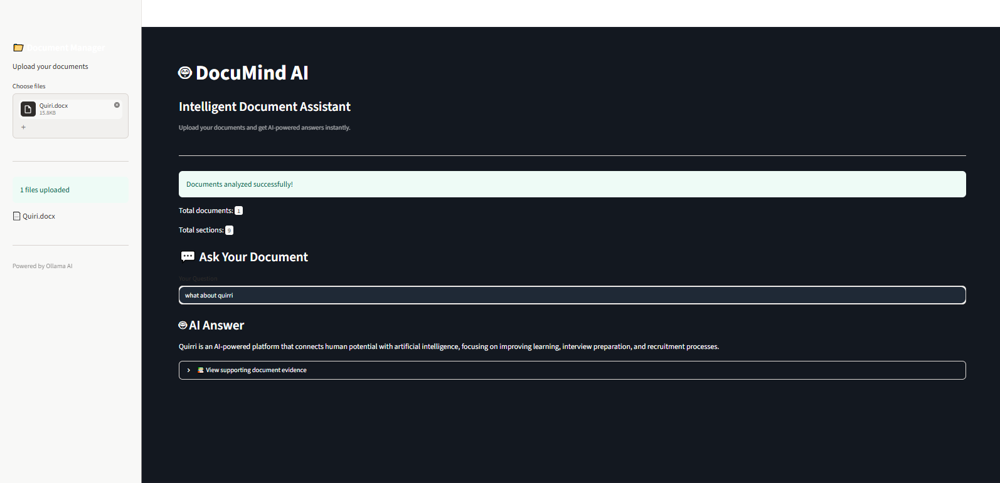

# 🤖 DocuMind AI – Intelligent Document Chatbot

## 📌 Project Overview

DocuMind AI is an intelligent document question-answering chatbot developed using Python, Streamlit, Ollama, and Retrieval-Augmented Generation (RAG).

Users can upload documents and ask questions in natural language. The chatbot retrieves relevant information from the uploaded documents and generates AI-powered answers.

## 🖥️ Application Screenshot



## 🚀 Key Features

- Upload multiple documents
- Supports PDF, DOCX, PPTX, and TXT files
- AI-powered question answering
- Semantic search using Sentence Transformers
- Retrieval-Augmented Generation (RAG)
- Local AI processing using Ollama
- Interactive Streamlit web interface
- Dark-themed user interface
- Document section detection
- Displays supporting document evidence

## 🛠️ Technologies Used

- Python
- Streamlit
- Ollama (Llama 3.2:3B)
- Sentence Transformers
- NumPy
- PyMuPDF
- python-docx
- python-pptx

## ⚙️ Installation

### 1. Clone the Repository

```bash
git clone https://github.com/Abisha62003/DocuMind-AI-Chatbot.git
```

### 2. Install Dependencies

```bash
pip install streamlit python-docx pymupdf requests numpy python-pptx sentence-transformers python-dateutil
```

### 3. Install Ollama

Download Ollama from:

https://ollama.com

### 4. Download the AI Model

```bash
ollama pull llama3.2:3b
```

### 5. Run the Application

```bash
streamlit run ai_document_chatbot.py
```

## 📂 Supported File Formats

| Format | Extension |
|--------|-----------|
| PDF | .pdf |
| Word | .docx |
| PowerPoint | .pptx |
| Text | .txt |

## 💡 How It Works

1. Upload documents using the Streamlit interface.
2. Extract text from uploaded files.
3. Split document content into sections and chunks.
4. Generate embeddings using Sentence Transformers.
5. Retrieve relevant document information.
6. Send the retrieved context to Ollama.
7. Display the AI-generated answer and supporting evidence.

## 🔮 Future Enhancements

- Chat history
- ChatGPT-style conversation interface
- Downloadable chat responses
- Improved document search
- Cloud deployment

## 👩‍💻 Project

Developed as a Python and Generative AI learning project.
